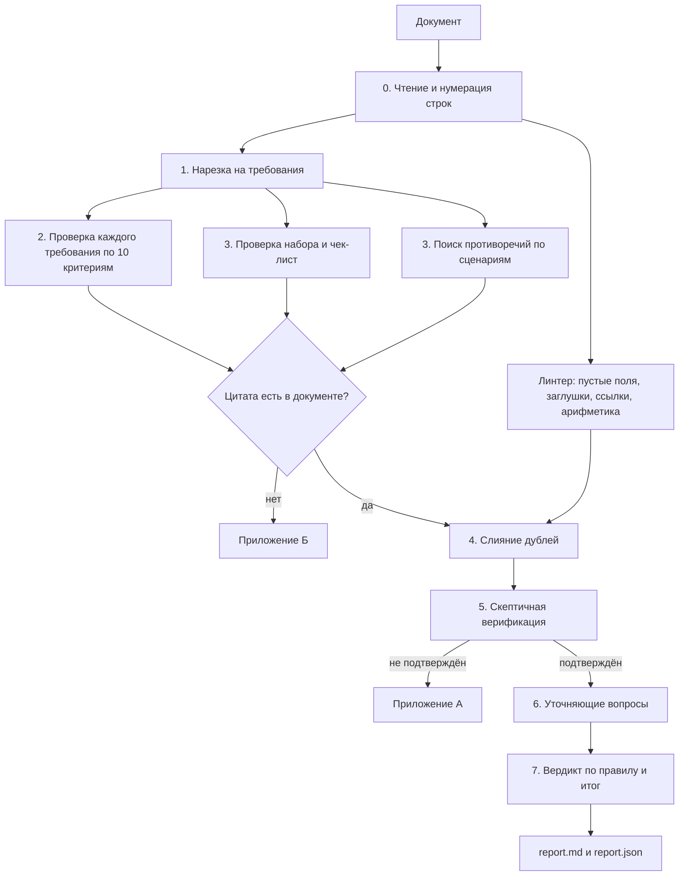

# reqcheck — агент проверки требований

Агент читает документ с требованиями к финтех-функции и **сам пишет отчёт на русском**: какие требования
нарушают качество (двусмысленные, непроверяемые, противоречивые, неполные), можно ли по документу начинать
разработку и что исправить в первую очередь. Каждое замечание привязано к дословной цитате и номеру строки.

**Что вы получите:** отчёт в двух видах с одинаковым содержанием: `report.md` (Markdown) и `report.txt` (простой текст для любого
редактора, без разметки), по желанию ещё JSON.
**Готовый отчёт по документу организаторов уже лежит в репозитории:** [report.md](report.md), [report.txt](report.txt).

---

## Запуск одной командой

Нужны Python 3.10 или новее и ключ API одной из двух моделей: [Google Gemini](https://aistudio.google.com/apikey)
(бесплатный, Create API key) или [Anthropic Claude](https://console.anthropic.com/settings/keys) (платный API).
Скачайте репозиторий и выполните **одну команду** в его папке.

Windows (PowerShell):

```powershell
git clone https://github.com/Alikhan0331/Verification_Agent.git
cd Verification_Agent
powershell -ExecutionPolicy Bypass -File .\run.ps1
```

Linux и macOS:

```bash
git clone https://github.com/Alikhan0331/Verification_Agent.git
cd Verification_Agent
bash run.sh
```

Скрипт сам создаёт окружение `.venv`, ставит зависимости и проверяет документ организаторов
`docs/requirements.md`. При первом запуске агент спросит, какую модель использовать (1 — Gemini, 2 — Claude),
и попросит вставить ключ: ввод скрыт, ключ сохраняется в `.env`, который в репозиторий не попадает.
Через 5–40 минут на Gemini (бесплатный тариф иногда перегружен, агент ждёт и повторяет запросы)
появятся `report.md` и `report.txt`.

### Запуск на Claude

Если ключ Anthropic уже есть, вопросов не будет. Задайте его в окружении и запустите:

```powershell
$env:ANTHROPIC_API_KEY = "sk-ant-..."
powershell -ExecutionPolicy Bypass -File .
un.ps1 --provider anthropic
```

```bash
export ANTHROPIC_API_KEY=sk-ant-...
bash run.sh --provider anthropic
```

По умолчанию используется `claude-opus-5-5`, запасная модель `claude-sonnet-5-5` (меняются в `.env`:
`ANTHROPIC_MODEL`, `ANTHROPIC_FALLBACK_MODELS`; или параметром `--model`). Ответы модели идут через
структурированный JSON-вывод API; если API отвергнет схему, клиент сам переключится на вызов инструмента.
Прогон на Claude обычно занимает несколько минут. Ключ из окружения подхватывается и без `--provider`, если
ключа Gemini нет.

Свой документ и параметры передаются после имени скрипта: `.\run.ps1 путь\к\документу.docx отчёт.md`
или `bash run.sh путь/к/документу.docx отчёт.md`.

**Уточняющие вопросы.** Когда проверка закончится, а запуск идёт в обычном терминале, агент напишет, сколько
вопросов подготовил, и спросит `Ответить на них сейчас в терминале? [Y/n]`. Enter запускает диалог (описан ниже),
`n` пропускает: вопросы всё равно записаны в раздел 7 отчёта. Флаг `--ask` начинает диалог без этого вопроса,
`--no-ask` отключает предложение. Без терминала (автоматический запуск) агент ничего не спрашивает.

> Скрипты проверены на Windows 10 с Windows PowerShell 5.1. `run.sh` для Linux и macOS на этих системах
> не запускался (проверен только синтаксис); если он не сработает, используйте ручной запуск ниже.

---

## Запуск вручную (5 шагов)

Если скрипт не подошёл. Команды ниже для Windows PowerShell; для Linux и macOS отличия указаны в комментариях.

**1. Скачайте репозиторий и перейдите в его папку.**

```powershell
git clone https://github.com/Alikhan0331/Verification_Agent.git
cd Verification_Agent
```

**2. Создайте окружение и поставьте зависимости.**

Windows (PowerShell). Используйте команду `py`, а не `python`: на некоторых компьютерах `python` указывает на
Python от MSYS2 или на заглушку Microsoft Store, и окружение получается неправильным.

```powershell
py -m venv .venv
.\.venv\Scripts\Activate.ps1
pip install -r requirements.txt
```

Linux и macOS:

```bash
python3 -m venv .venv
source .venv/bin/activate
pip install -r requirements.txt
```

После активации в начале строки терминала появится `(.venv)`.

**3. Получите бесплатный ключ Gemini.** Откройте [Google AI Studio](https://aistudio.google.com/apikey),
войдите аккаунтом Google и нажмите **Create API key**. Платный тариф не нужен.

**4. Положите ключ в файл `.env`.**

```powershell
copy .env.example .env              # Linux/macOS: cp .env.example .env
```

Откройте `.env` в любом редакторе и замените `your_gemini_api_key_here` на свой ключ. Больше ничего менять не нужно.
Файл `.env` в репозиторий не попадает (он в `.gitignore`).

**5. Запустите проверку. Это одна команда: путь к документу и путь к отчёту.**

```powershell
python -m reqcheck docs/requirements.md report.md
```

Пока агент работает, он печатает шаги (`[1/7] … [7/7]`). Прогон занимает **от 5 до 40 минут** (бесплатный Gemini
иногда перегружен, тогда агент ждёт и повторяет запросы). В конце появятся файлы `report.md` и `report.txt` (одно и то же, в разном виде).
Свой документ проверяется так же: `python -m reqcheck путь\к\документу.docx отчёт.md`.
Поддерживаются `.md`, `.txt`, `.docx` и `.pdf` (с текстовым слоем).

**Формат отчёта.** Организаторы не требуют конкретного формата, поэтому отчёт сохраняется сразу в двух:
`report.md` и рядом `report.txt` (заголовки подчёркнуты, таблицы превращены в строки, цитаты из документа дословные).
Нужен только текст: укажите путь с `.txt`, например `python -m reqcheck docs/requirements.md report.txt`.
Не нужна копия: добавьте `--no-txt`. Текст строит код из готового отчёта, модель в нём не участвует; для старого
отчёта: `python -m reqcheck.textout report.md report.txt`.

> Если в конце прогона вы видите «Предупреждение (шаблон отчёта)» — агент сам проверил свой отчёт на соответствие
> шаблону из задания и нашёл недостаток. Если предупреждений нет, отчёт соответствует шаблону.

### Если что-то пошло не так

| Что видите | Что делать |
| :-- | :-- |
| `Activate.ps1 не распознано`, а в папке `.venv` есть `bin` вместо `Scripts` | Окружение создал не тот Python (`python` указывает на MSYS2). Удалите папку: `Remove-Item -Recurse -Force .venv`, создайте заново командой `py -m venv .venv` и повторите шаг 2. Без активации тоже можно: `.\.venv\Scripts\python.exe -m pip install -r requirements.txt`, а запуск `.\.venv\Scripts\python.exe -m reqcheck docs/requirements.md report.md`. |
| `выполнение сценариев отключено` при активации | В этом окне PowerShell: `Set-ExecutionPolicy -Scope Process Bypass`, затем снова `.\.venv\Scripts\Activate.ps1`. |
| `Не задан GEMINI_API_KEY` или `ANTHROPIC_API_KEY` | Запустите в обычном терминале (тогда агент сам спросит ключ) или положите ключ в `.env` рядом с `README.md` (шаг 4) либо в переменную окружения. |
| `суточная квота … исчерпана` | У бесплатного Gemini лимит около 20 запросов в сутки на модель, а прогон делает 20–30. Агент сам переходит на запасные модели из `GEMINI_FALLBACK_MODELS` (они уже прописаны в `.env.example`). Если не помогло, подождите сброса (раз в сутки), возьмите ключ другого проекта или добавьте несколько ключей: `GEMINI_API_KEYS=ключ1,ключ2`. |
| `перегрузка (503)` | Это не ошибка: модель занята, агент подождёт и повторит. |
| `model not found` или 404 | Google закрыл модель. В `.env` в `GEMINI_MODEL` впишите модель из списка в AI Studio (нужна модель с поддержкой JSON-режима). |
| Отчёт пишется слишком долго | Уменьшите `--workers 3` до `--workers 1` или добавьте `--min-interval 6`. |

Дополнительные параметры: `--json result.json` (машиночитаемый результат), `--no-verify` (пропустить проверяющий
проход), `--segmentation auto|rules|llm` (как нарезать на требования), `--set-passes 1` (быстрее и дешевле, но
менее надёжно искать противоречия), `--provider anthropic --model <id>` (другой провайдер; на реальных вызовах не проверялся).

---

## Что внутри отчёта

В [report.md](report.md) восемь разделов:

1. **Паспорт прогона:** документ, SHA-256, дата, модель, версия агента (коммит), число вызовов.
2. **Критерии:** 10 для каждого требования и 8 для набора целиком.
3. **Нарезка:** таблица «ID в отчёте — ID в документе — краткая формулировка».
4. **Проверка каждого требования:** матрица критериев и замечания с цитатами.
5. **Проверка набора:** противоречия, пропуски, чек-лист ревью из самого документа.
6. **Сводка:** сколько требований и дефектов, список критичных.
7. **Уточняющие вопросы автору документа:** вопрос, кто должен ответить, блокирует ли он разработку, варианты ответа, цитата.
8. **Итог:** можно ли начинать разработку и тестирование (ДА / УСЛОВНО / НЕТ) и что исправить в первую очередь.

Важность дефекта: **критичное** (по формулировке нельзя однозначно реализовать или проверить), **значительное**
(вероятна ошибка), **незначительное** (оформление). Вердикт считает не модель, а правило: есть критичные дефекты — «НЕТ»,
есть значительные — «УСЛОВНО», иначе «ДА».

Пример замечания из готового отчёта:

> **D-046 · Непротиворечивость · критичное.** Ф-3: «…максимум один такой push за календарный месяц.» Ф-4: «…следующее
> достижение вызывает push независимо от истории предыдущей настройки.» Сценарий: порог 20 000 ₸, push 5 мая; 10 мая
> порог повышен до 40 000 ₸ — по Ф-3 второй push запрещён, по Ф-4 обязателен. *Как исправить:* определить приоритет правил.

**Про модели в паспорте.** Бесплатный Gemini ограничивает число запросов и временами перегружен, поэтому агент при
необходимости автоматически переключается на запасные модели из `GEMINI_FALLBACK_MODELS`. В паспорте отчёта
записано, сколько ответов дала каждая модель. В `report.md` из репозитория основной моделью была `gemini-3.8-flash`,
часть запросов обслужили запасные модели Gemini.

---

## Диалог с агентом: ответы автора на вопросы

Агент не только находит дефекты, но и принимает ответы автора на свои вопросы и обновляет отчёт.
Есть два способа: диалог прямо во время запуска и ответы из файла.

### Способ 1. Вопросы и ответы в терминале (`--ask`)

```powershell
python -m reqcheck docs/requirements.md report.md --ask
```

(Без `--ask` в обычном терминале агент сам предложит этот диалог после проверки.)
После проверки агент по очереди задаёт вопросы, сначала те, что блокируют разработку:

```
─── Вопрос 1 из 21 · Q-01 · блокирует разработку и тестирование · адресат: владелец продукта ───
В документе (строка 23): «в момент покупки»
По какой дате определяется месяц покупки для накопительного счётчика расходов: …?
  А) По дате и времени авторизации (совершения) в часовом поясе г. Алматы (Asia/Almaty)
  Б) По дате финансового проведения (клиринга/списания) по времени г. Алматы
  В) По дате авторизации в UTC
Ваш ответ (буква варианта или свой ответ; Enter — пропустить, q — закончить):
```

Ответьте буквой или цифрой варианта, либо своими словами. `Enter` пропускает вопрос, `q` заканчивает опрос.
Затем агент оценивает ответы (по таблице ниже), закрывает дефекты, пересчитывает вердикт и, если ответ неполный,
задаёт узкий уточняющий вопрос (до двух кругов). В `report.md` попадает весь диалог: вопрос, ответ и оценка,
рядом сохраняется `report.answers.md`. Без флага `--ask` агент ничего не спрашивает и ввода не ждёт, а вопросы
просто записаны в разделе 7 отчёта; так запуск работает и в автоматических проверках.

**Пример настоящего диалога** лежит в [examples/dialog/](examples/dialog/): прогон на документе организаторов
27.11.2026, основная модель `gemini-3.8-flash`, ответы дала `gemini-3.6-flash` (запасная модель при перегрузке).
Тестировщик ответил на четыре вопроса ([answers_given.md](examples/dialog/answers_given.md)): выбрал варианты
для Q-01, Q-03, Q-04 и написал «Позже определим» на Q-02. Результат в
[report_after_dialog.md](examples/dialog/report_after_dialog.md): три ответа закрыли три критичных дефекта
(они в «Приложении В»), ответ «Позже определим» ничего не закрыл, и агент задал уточнение Q-16.
Это отдельный прогон: число дефектов в нём (22) отличается от основного отчёта, а ответы тестировщик выбирал
для проверки механики, а не как решения по продукту.

### Способ 2. Ответы из файла

Заново проверять документ не нужно: режим работает поверх готового `report.json`.

```powershell
python -m reqcheck docs/requirements.md report.md --json report.json                 # 1. проверка (+ вопросы)
python -m reqcheck.reply template docs/requirements.md report.json answers.md         # 2. шаблон ответов (без модели)
# 3. автор вписывает ответы после слов «Ответ:» (буква варианта или своими словами); пример: examples/answers_demo.md
python -m reqcheck.reply apply docs/requirements.md report.json answers.md report_after.md --json report_after.json
```

Агент оценивает каждый ответ и делает следующее:

| Оценка ответа | Что происходит |
| :-- | :-- |
| Закрывает дефекты | Дефекты уходят в «Приложение В», вердикт и итог пересчитываются, агент предлагает готовую формулировку для вставки в документ. |
| Закрывает частично | Закрытые дефекты уходят, по остальному задаётся более узкий вопрос. |
| Недостаточно («позже», «по усмотрению») | Ничего не закрывается, добавляется более узкий вопрос. |
| Противоречит документу | Создаётся новый дефект с цитатой конфликтующего места и вопрос, как согласовать. |

Если документ после проверки изменили, ответы не применятся (отчёт привязан к документу по SHA-256).
Для этого режима нужна сильная модель: на lite-моделях ответы оцениваются слишком мягко.

---

## Как работает агент

Конвейер из семи ролей. У каждой свой промпт и свой формат результата; между ролями передаются только проверяемые
факты: цитаты, номера строк, коды критериев. Всё, что можно посчитать кодом, считает код.



| Шаг | Что делает | Кто |
| :-- | :-- | :-- |
| 0. Чтение | Документ превращается в пронумерованные строки (для PDF запоминается страница) | код |
| 1. Нарезка | Выделяет отдельные требования, сохраняет номер из документа или присваивает свой (`R-01`…). Для md/docx по разметке (без модели, поэтому всегда одинаково), для PDF моделью | код / модель |
| 2. Требования | Каждое требование проверяется по 10 критериям, пачками по 10, параллельно, с контекстом всего документа | модель |
| 3. Набор | Две независимые проверки: общая (с чек-листом из документа) и отдельный поиск противоречий по сценариям с числами и датами; обе повторяются 2 раза. Рядом линтер ловит пустые разделы, «определим позже», битые ссылки, арифметические ошибки | модель + код |
| 4. Дубли | Одна проблема, найденная в разных местах, сливается в один дефект | модель + код |
| 5. Верификация | Скептичный проход по критичным и значительным дефектам: «подтверждается ли цитатой?» | модель |
| 6. Вопросы | Для каждого критичного и значительного дефекта вопрос автору; код проверяет, что ни один дефект не остался без вопроса | модель + код |
| 7. Итог | Вердикт по правилу, модель пишет обоснование и очередь исправлений | код + модель |

**Защита от выдумок.** Каждое замечание обязано нести дословную цитату. Агент сам находит её в тексте и сам вычисляет
номер строки. Цитаты, которых в документе нет, отбрасываются (Приложение Б отчёта), а замечания, которые проверяющий
проход не подтвердил, показываются отдельно (Приложение А).

---

## Насколько агент точен

Чтобы это измерить, создан корпус из 7 документов (`tests/corpus/`): 5 с намеренно заложенными дефектами и 2 чистых
контрольных. У каждого дефекта записаны дословные цитаты; дефект агента засчитывается, если совпал критерий и цитаты
покрывают нужные места. Корпус синтетический (написан для проверки), настоящие требования бывают неряшливее.

| Документ | Заложено | Найдено агентом | Критичные |
| :-- | :-: | :-: | :-: |
| документ организаторов | 24 | 22–24 (в последних прогонах 22) | 5 из 5 |
| `loan_prepayment` | 13 | 13 | 3 из 3 |
| `p2p_limits` | 13 | 13 | 5 из 5 |
| `otp_login` | 13 | 13 | 6 из 6 |
| `cashback_accrual` | 14 | 11–12 | 3 из 3 |
| `autopay_utilities` | 14 | 11 | 3 из 3 |
| контрольный `card_freeze_clean` (без дефектов) | — | — | замечаний нет |
| контрольный `card_statement_clean` (без дефектов) | — | — | 3 значительных (правдоподобные пробелы) |

Цифры собраны из прогонов на сильных моделях Gemini в разное время (разные версии промптов), поэтому диапазоны.
**Результат одного прогона заметно плавает:** на документе организаторов за сутки получилось от 75% до 100%
заложенных дефектов (типично 75–92%). Лежащий в репозитории `report.md` — первый прогон (24 из 24), лучший из шести.
Оценка запускается так: `python -m reqcheck.eval tests/corpus --run --results eval_out --only otp_login`.

**Что не проверено.** Anthropic-провайдер на реальных вызовах с настоящим ключом (клиент проверен тестами с заглушкой SDK и запросом к API с неверным ключом: ответ 401 приходит от сервера). Достаточная статистика по повторным прогонам
(мешает суточный лимит бесплатного тарифа). Вклад повторного прохода проверки набора отдельно от правки промпта.
Режим ответов автора (файл и диалог --ask) проверен тестами с заглушкой модели и тремя реальными прогонами: один на lite-модели и два на сильных моделях (примеры ответов подавались заранее, это проверка механики).

Тесты (без сети, модель заменена заглушкой): `pip install -r requirements-dev.txt` и `pytest -q` (125 тестов).

---

## Что лежит в репозитории

```
report.md, report.txt, report.json   отчёт агента по документу организаторов (.txt — тот же отчёт простым текстом)
docs/requirements.md     входной документ организаторов (не результат работы)
reqcheck/                код агента
examples/                примеры: файл ответов автора (answers_demo.md) и результат диалога (dialog/)
tests/                   тесты; tests/corpus/ — учебные документы с заложенными дефектами и эталоны
.env.example             пример настроек без ключа
requirements.txt         зависимости (requirements-dev.txt — для тестов)
```
