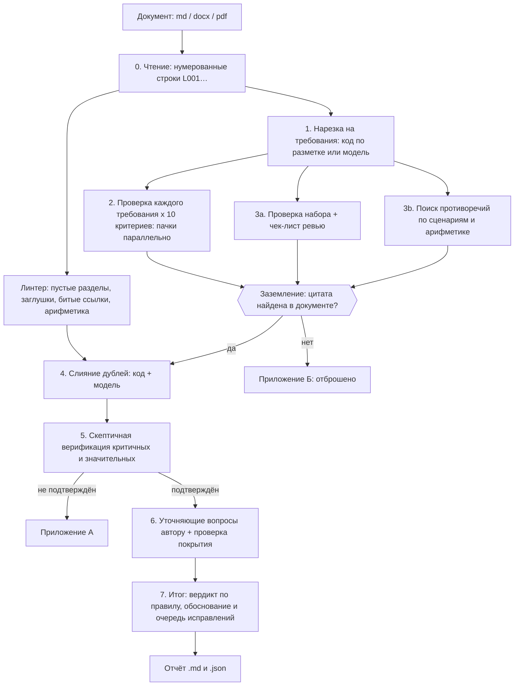

# reqcheck — агент проверки требований

ИИ-агент для хакатона BCC-HUB × MNU FinTech: статическая проверка готового документа с требованиями
(ревью до разработки) и отчёт на русском языке.

> **Статус: рабочий прототип.** Код, офлайн-тесты и оценка на корпусе с заложенными дефектами готовы;
> боевые прогоны на Gemini сделаны, но качество промптов ещё калибруется (см. «Оценка качества» и «Что не проверено»).

## Быстрый старт

Нужен Python 3.10+.

```bash
python -m venv .venv
.venv\Scripts\activate          # Linux/macOS: source .venv/bin/activate
pip install -r requirements.txt
copy .env.example .env          # Linux/macOS: cp .env.example .env
```

1. Получите бесплатный ключ в [Google AI Studio](https://aistudio.google.com/) → *Get API key*.
2. Откройте `.env`, вставьте ключ в `GEMINI_API_KEY`, при необходимости поменяйте `GEMINI_MODEL`
   (список доступных вам моделей — в AI Studio; нужна модель с поддержкой JSON-режима).
3. Запустите прогон — одна команда: путь к требованиям и путь к отчёту.

```bash
python -m reqcheck docs/requirements.md report.md
```

Отчёт ляжет в `report.md` (путь второго аргумента). Ход работы идёт в stderr.
Работает с `.pdf` (с текстовым слоем), `.md`, `.txt`, `.docx`.

Дополнительно: `--json result.json` (машиночитаемый результат), `--batch-size 10`, `--workers 3`
(параллельные вызовы), `--no-verify`, `--provider anthropic --model <id>`, `--min-interval 6`
(пауза между стартами вызовов для лимитов бесплатного тарифа), `--segmentation auto|rules|llm`
(нарезка на требования: по разметке документа без модели / только моделью; по умолчанию `auto`).
Если ловите ошибки 429, уменьшите `--workers`.

**Лимиты бесплатного тарифа.** У Gemini около 20 запросов в сутки на модель, полный прогон — 9–13 вызовов.
Если модель исчерпала суточную квоту или закрыта, агент не тратит попытки, а переходит на следующую модель
из `GEMINI_FALLBACK_MODELS` (через запятую, см. `.env.example`); использованные модели видны в паспорте отчёта.
Если заданы несколько ключей `GEMINI_API_KEYS` (по одному на проект Google), вызовы чередуются между ними, а ключ с исчерпанной квотой
выбывает; на следующую модель агент переходит, только когда квота кончилась у всех ключей. Ключи хранятся только в локальном `.env`.

Модель: Google периодически закрывает старые модели для новых аккаунтов (`gemini-2.5-flash`
на момент прогона уже была недоступна). Список доступных моделей — в AI Studio; прогон делался на `gemini-3.8-flash`.

Тесты (без сети, модель заменена заглушкой): `pip install -r requirements-dev.txt && pytest -q`.

Самопроверка шаблона: после записи отчёта агент сверяет его с разделами шаблона ТЗ (`reqcheck/conformance.py`)
и печатает предупреждения, если чего-то не хватает.

## Как работает

Конвейер из семи ролей. У каждой роли свой промпт, свой вход и свой контракт на выход (схема); роли не видят
рассуждений друг друга, а передают только проверяемые факты: цитаты, номера строк, коды критериев.
Всё, что можно посчитать кодом, считает код, а не модель.



| Шаг | Роль | Что делает | Кто |
| :-- | :-- | :-- | :-- |
| 0. Чтение | Читатель | Документ → пронумерованные строки `L001…` (для PDF запоминается страница) | код |
| 1. Нарезка | Нарезчик | Выделяет отдельные требования, сохраняет номер из документа или присваивает `R-xx`. Для документов с разметкой (md/docx) — правилами по заголовкам, спискам и таблицам, без модели и без разброса от прогона к прогону; для плоского текста (PDF) — моделью | код / модель |
| 2. Требования | Проверяющий | Каждое требование × 10 критериев (пачками по 10, с контекстом всего документа, пачки идут параллельно) | модель |
| 3. Набор | Аудитор набора и охотник за противоречиями | Два независимых прохода: общая проверка набора (+ чек-лист из документа, если он есть) и отдельный поиск противоречий по сценариям с числами и датами. Рядом работает линтер: пустые разделы, заглушки, «определим позже», битые ссылки, арифметика сумм, Content-Type при пустом теле | модель + код |
| 4. Дубли | Редактор | Одна проблема, найденная в разных местах, сливается в один дефект: остаётся сквозной дефект набора (противоречие, несколько мест), иначе точный дефект по требованию | модель + код |
| 5. Верификация | Скептик | Независимый проход по критичным и значительным дефектам: «подтверждается ли цитатой?». Дефекты линтера проверке не подлежат: они найдены кодом | модель |
| 6. Вопросы | Интервьюер | Для каждого критичного и значительного дефекта формулирует уточняющий вопрос автору документа с вариантами ответа и адресатом; код проверяет, что ни один дефект не остался без вопроса, и добирает недостающие | модель + код |
| 7. Итог | Вердикт | Вердикт считается правилом (есть критичные → «нет»; есть значительные → «условно»), модель пишет обоснование и очередь исправлений | код + модель |

**Почему так.** Нарезка по разметке исключает разброс числа требований между прогонами; вердикт по правилу
исключает «мягкий» итог при критичных дефектах; линтер даёт нижнюю планку качества независимо от модели;
отдельный скептик снижает долю ложных срабатываний (на контрольных документах без дефектов их нет);
вопросы с проверкой покрытия превращают список недостатков в рабочий план для автора. Слой связи с моделью
переживает суточные лимиты и перегрузки: ротация ключей, цепочка резервных моделей, повторы при сетевых сбоях
и таймаут запроса (`reqcheck/llm.py`).

**Защита от выдумок.** Каждое замечание обязано нести дословную цитату. Агент сам ищет цитату в тексте,
сам вычисляет номера строк (и страницу в PDF); если фраза встречается в документе несколько раз,
берётся вхождение, ближайшее к самому требованию. Цитаты, которых в документе нет, отбрасываются и попадают
в «Приложение Б» отчёта. Отклонённые верификатором замечания — в «Приложении А».

**Критерии** — ISO/IEC/IEEE 29148:2018 п. 5.2.5 (необходимость, уместность детализации, однозначность,
полнота, единичность, реализуемость, проверяемость, корректность, соответствие шаблону) и п. 5.2.6
(полнота, непротиворечивость, реализуемость, понятность, валидируемость набора), а также IEEE 830-1998
п. 4.3 (прослеживаемость, модифицируемость, ранжирование). Определения — в `reqcheck/criteria.py`.

## Состав отчёта

1. Паспорт прогона: документ, SHA-256, дата, модель, версия агента (`git describe`), число вызовов.
2. Критерии.
3. Нарезка: таблица «ID в отчёте — ID в документе — краткая формулировка» (+ цитата, если номера нет).
4. Проверка каждого требования: матрица критериев и замечания с цитатами и строками.
5. Проверка набора целиком (+ чек-лист ревью из документа).
6. Сводка: число требований, дефектов, критичные (непроверяемые, противоречивые, неполные).
7. Уточняющие вопросы к автору документа: вопрос, адресат, признак «блокирует разработку», варианты ответа,
   цитата-основание и D-номера дефектов, которые закроет ответ.
8. Итог: можно ли начинать разработку и тестирование, что исправить первым.

## Структура репозитория

```
reqcheck/        код агента (loader, segmenter, grounding, prompts, pipeline, report, conformance, llm, eval, cli)
tests/           офлайн-тесты
tests/corpus/    учебные документы с заложенными дефектами (`*.md`) и эталоны (`*.expected.json`)
NIGHT_NOTES.md   рабочий журнал: состояние, результаты оценки, следующие шаги
docs/requirements.md   входной документ организаторов (не результат работы)
.env.example     пример конфига без ключа
requirements.txt зависимости
```

## Оценка качества

В `tests/corpus/` лежат три учебных документа с намеренно заложенными дефектами, один чистый контрольный
и эталон дефектов для документа организаторов. Эталон — это «семена»: критерий(и), серьёзность и дословные
цитаты-якоря. Дефект агента засчитывается, если его критерий входит в список семени, а цитаты покрывают нужное число якорей.

```bash
python -m reqcheck.eval tests/corpus --results eval_out --only otp_login            # оценить готовый прогон
python -m reqcheck.eval tests/corpus --run --out eval_out --only otp_login          # прогнать агента и оценить
```

Текущие цифры (подробности и история — в `NIGHT_NOTES.md`): итоговый отчёт на документе организаторов (версия `02cdaa9`, сильные модели Gemini) — 24 из 24 (100%), критичных 5 из 5, 21 уточняющий вопрос, вердикт «НЕТ»; первый отчёт был 21 из 24 (88%);
`otp_login` на слабых lite-моделях — 54% → 77% после исправления слияния дублей, критичные 5–6 из 6.
Разброс между прогонами заметный, поэтому сравнивать версии нужно на нескольких документах.

## Что не проверено

- Anthropic-провайдер на реальных вызовах: схемы собираются, сеть не использовалась.
- Повторяемость итогового прогона: он один; разброс между прогонами на сильных моделях не измерен (мешает суточная квота).
- Качество найденных дефектов зависит от модели; промпты калибруются по прогонам на корпусе.
