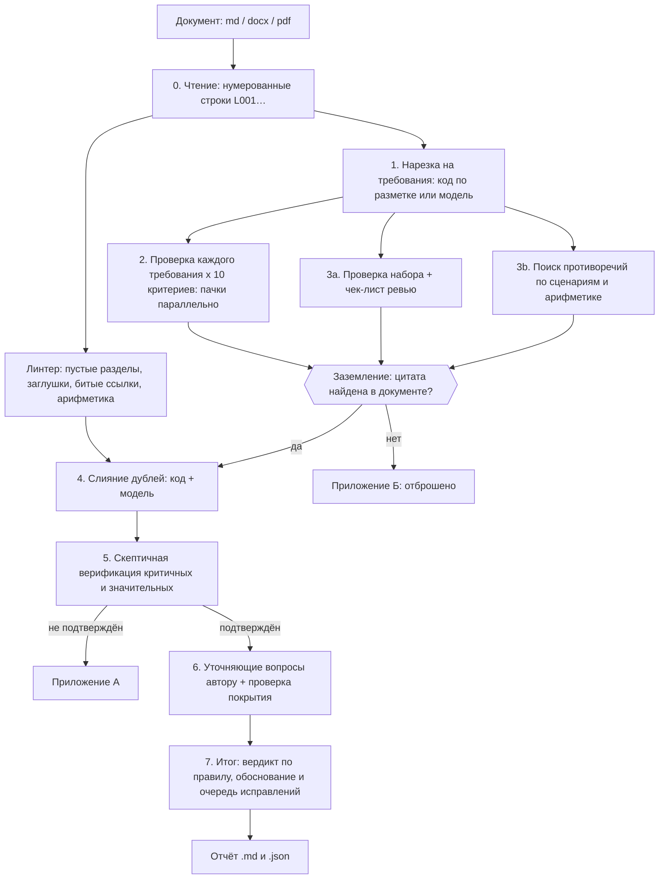

# reqcheck — агент проверки требований

ИИ-агент для хакатона BCC-HUB × MNU FinTech: статическая проверка готового документа с требованиями
(ревью до разработки) и отчёт на русском языке.

> Агент работает на бесплатном Gemini API. Готовый отчёт по документу организаторов — `report.md` (и `report.json`),
> он создан этим агентом. Результаты проверки на собственном корпусе и ограничения — в разделах «Оценка качества»
> и «Что не проверено».

## Быстрый старт

Нужен Python 3.10+.

```bash
python -m venv .venv
.venv\Scripts\activate          # Linux/macOS: source .venv/bin/activate
pip install -r requirements.txt
copy .env.example .env          # Linux/macOS: cp .env.example .env
```

1. Получите бесплатный ключ в [Google AI Studio](https://aistudio.google.com/) → *Get API key*.
2. Откройте `.env`, вставьте ключ в `GEMINI_API_KEY`, при необходимости поменяйте `GEMINI_MODEL`
   (список доступных вам моделей — в AI Studio; нужна модель с поддержкой JSON-режима).
3. Запустите прогон — одна команда: путь к требованиям и путь к отчёту.

```bash
python -m reqcheck docs/requirements.md report.md
```

Отчёт ляжет в `report.md` (путь второго аргумента). Ход работы идёт в stderr.
Работает с `.pdf` (с текстовым слоем), `.md`, `.txt`, `.docx`.

Дополнительно: `--json result.json` (машиночитаемый результат), `--batch-size 10`, `--workers 3`
(параллельные вызовы), `--no-verify`, `--provider anthropic --model <id>`, `--min-interval 6`
(пауза между стартами вызовов для лимитов бесплатного тарифа), `--segmentation auto|rules|llm`
(нарезка на требования: по разметке документа без модели / только моделью; по умолчанию `auto`).
Если ловите ошибки 429, уменьшите `--workers`.

**Лимиты бесплатного тарифа.** У Gemini около 20 запросов в сутки на модель, полный прогон — 9–13 вызовов.
Если модель исчерпала суточную квоту или закрыта, агент не тратит попытки, а переходит на следующую модель
из `GEMINI_FALLBACK_MODELS` (через запятую, см. `.env.example`); использованные модели видны в паспорте отчёта.
Если заданы несколько ключей `GEMINI_API_KEYS` (по одному на проект Google), вызовы чередуются между ними, а ключ с исчерпанной квотой
выбывает; на следующую модель агент переходит, только когда квота кончилась у всех ключей. Ключи хранятся только в локальном `.env`.

Модель: Google периодически закрывает старые модели для новых аккаунтов (`gemini-2.5-flash`
на момент прогона уже была недоступна). Список доступных моделей — в AI Studio; прогон делался на `gemini-3.8-flash`.

Тесты (без сети, модель заменена заглушкой): `pip install -r requirements-dev.txt && pytest -q`.

Самопроверка шаблона: после записи отчёта агент сверяет его с разделами шаблона ТЗ (`reqcheck/conformance.py`)
и печатает предупреждения, если чего-то не хватает.

## Как работает

Конвейер из семи ролей. У каждой роли свой промпт, свой вход и свой контракт на выход (схема); роли не видят
рассуждений друг друга, а передают только проверяемые факты: цитаты, номера строк, коды критериев.
Всё, что можно посчитать кодом, считает код, а не модель.



| Шаг | Роль | Что делает | Кто |
| :-- | :-- | :-- | :-- |
| 0. Чтение | Читатель | Документ → пронумерованные строки `L001…` (для PDF запоминается страница) | код |
| 1. Нарезка | Нарезчик | Выделяет отдельные требования, сохраняет номер из документа или присваивает `R-xx`. Для документов с разметкой (md/docx) — правилами по заголовкам, спискам и таблицам, без модели и без разброса от прогона к прогону; для плоского текста (PDF) — моделью | код / модель |
| 2. Требования | Проверяющий | Каждое требование × 10 критериев (пачками по 10, с контекстом всего документа, пачки идут параллельно) | модель |
| 3. Набор | Аудитор набора и охотник за противоречиями | Два независимых прохода: общая проверка набора (+ чек-лист из документа, если он есть) и отдельный поиск противоречий по сценариям с числами и датами. Рядом работает линтер: пустые разделы, заглушки, «определим позже», битые ссылки, арифметика сумм, Content-Type при пустом теле | модель + код |
| 4. Дубли | Редактор | Одна проблема, найденная в разных местах, сливается в один дефект: остаётся сквозной дефект набора (противоречие, несколько мест), иначе точный дефект по требованию | модель + код |
| 5. Верификация | Скептик | Независимый проход по критичным и значительным дефектам: «подтверждается ли цитатой?». Дефекты линтера проверке не подлежат: они найдены кодом | модель |
| 6. Вопросы | Интервьюер | Для каждого критичного и значительного дефекта формулирует уточняющий вопрос автору документа с вариантами ответа и адресатом; код проверяет, что ни один дефект не остался без вопроса, и добирает недостающие | модель + код |
| 7. Итог | Вердикт | Вердикт считается правилом (есть критичные → «нет»; есть значительные → «условно»), модель пишет обоснование и очередь исправлений | код + модель |

**Почему так.** Нарезка по разметке исключает разброс числа требований между прогонами; вердикт по правилу
исключает «мягкий» итог при критичных дефектах; линтер даёт нижнюю планку качества независимо от модели;
отдельный скептик снижает долю ложных срабатываний (на контрольных документах без дефектов их нет);
вопросы с проверкой покрытия превращают список недостатков в рабочий план для автора. Слой связи с моделью
переживает суточные лимиты и перегрузки: ротация ключей, цепочка резервных моделей, повторы при сетевых сбоях
и таймаут запроса (`reqcheck/llm.py`).

**Защита от выдумок.** Каждое замечание обязано нести дословную цитату. Агент сам ищет цитату в тексте,
сам вычисляет номера строк (и страницу в PDF); если фраза встречается в документе несколько раз,
берётся вхождение, ближайшее к самому требованию. Цитаты, которых в документе нет, отбрасываются и попадают
в «Приложение Б» отчёта. Отклонённые верификатором замечания — в «Приложении А».

**Критерии** — ISO/IEC/IEEE 29148:2018 п. 5.2.5 (необходимость, уместность детализации, однозначность,
полнота, единичность, реализуемость, проверяемость, корректность, соответствие шаблону) и п. 5.2.6
(полнота, непротиворечивость, реализуемость, понятность, валидируемость набора), а также IEEE 830-1998
п. 4.3 (прослеживаемость, модифицируемость, ранжирование). Определения — в `reqcheck/criteria.py`.

## Состав отчёта

1. Паспорт прогона: документ, SHA-256, дата, модель, версия агента (`git describe`), число вызовов.
2. Критерии.
3. Нарезка: таблица «ID в отчёте — ID в документе — краткая формулировка» (+ цитата, если номера нет).
4. Проверка каждого требования: матрица критериев и замечания с цитатами и строками.
5. Проверка набора целиком (+ чек-лист ревью из документа).
6. Сводка: число требований, дефектов, критичные (непроверяемые, противоречивые, неполные).
7. Уточняющие вопросы к автору документа: вопрос, адресат, признак «блокирует разработку», варианты ответа,
   цитата-основание и D-номера дефектов, которые закроет ответ.
8. Итог: можно ли начинать разработку и тестирование, что исправить первым.

## Режим ответов автора (диалог с агентом)

Агент не только находит дефекты, но и ведёт уточняющий диалог: задаёт вопросы, принимает ответы автора,
оценивает их и обновляет отчёт. Повторно проверять весь документ не нужно: режим работает поверх готового `report.json`.

```bash
python -m reqcheck docs/requirements.md report.md --json report.json                  # 1. проверка и вопросы (раздел 7 отчёта)
python -m reqcheck.reply template docs/requirements.md report.json answers.md          # 2. шаблон: блок на каждый вопрос
#   автор вписывает ответы после «Ответ:» (буква варианта или своими словами; пустой ответ = «пока без ответа»)
python -m reqcheck.reply apply docs/requirements.md report.json answers.md report_after.md --json report_after.json
```

Что делает агент с каждым ответом:

| Оценка | Смысл | Что происходит |
| :-- | :-- | :-- |
| закрывает дефекты | ответ конкретен и проверяем | дефекты уходят в «Приложение В», вердикт и итог пересчитываются, агент даёт готовую формулировку для вставки в документ |
| закрывает частично | закрыта часть составного вопроса | закрытые дефекты уходят, по остальному агент задаёт более узкий вопрос |
| недостаточно | «позже», «по усмотрению», нет значения | ничего не закрывается, добавляется более узкий вопрос |
| противоречит документу | ответ конфликтует с другим местом (с дословной цитатой) | создаётся новый дефект, добавляется вопрос, как согласовать |

Защиты: отчёт привязан к документу по SHA-256 (если документ изменился, ответы не применяются); код сам
проверяет, что закрываются только дефекты этого вопроса, и недостаточный ответ ничего не закрывает, даже
если модель ошиблась; цитата конфликта обязана находиться в документе. Пример файла ответов: `examples/answers_demo.md`.

## Структура репозитория

```
reqcheck/        код агента (loader, segmenter, lint, grounding, prompts, pipeline, report, conformance, llm, eval, reply, cli)
examples/        пример файла ответов автора на вопросы агента (`answers_demo.md`)
tests/           офлайн-тесты
tests/corpus/    учебные документы с заложенными дефектами (`*.md`) и эталоны (`*.expected.json`)
docs/requirements.md   входной документ организаторов (не результат работы)
report.md, report.json отчёт агента по документу организаторов
.env.example     пример конфига без ключа
requirements.txt зависимости (requirements-dev.txt — для тестов)
```

## Оценка качества

В `tests/corpus/` лежат пять учебных документов с намеренно заложенными дефектами, два чистых контрольных
и эталон дефектов для документа организаторов. Эталон — это «семена»: критерий(и), серьёзность и дословные
цитаты-якоря. Дефект агента засчитывается, если его критерий входит в список семени, а цитаты покрывают нужное число якорей.

```bash
python -m reqcheck.eval tests/corpus --results eval_out --only otp_login            # оценить готовый прогон
python -m reqcheck.eval tests/corpus --run --out eval_out --only otp_login          # прогнать агента и оценить
```

Текущие цифры, версия `2fdcbeb`, сильные модели Gemini (без lite), один прогон на документ:

| Документ | Заложено | Найдено | Критичные |
| :-- | :-: | :-: | :-: |
| документ организаторов (`docs/requirements.md`) | 24 | 24 (100%) | 5 из 5 |
| `loan_prepayment` | 13 | 13 (100%) | 3 из 3 |
| `p2p_limits` | 13 | 13 (100%) | 5 из 5 |
| `otp_login` | 13 | 12 (92%) | 5 из 6 |
| `cashback_accrual` | 14 | 12 (86%) | 2 из 3 |
| `autopay_utilities` | 14 | 11 (79%) | 3 из 3 |
| **Итого** | **91** | **85 (93%)** | **23 из 25** |
| контрольные документы без дефектов (`card_statement_clean`, `card_freeze_clean`) | — | — | критичных и значительных замечаний: 0 |

Эта таблица — версия до последних двух правок. После них (версия `bc9b1b6`: проверка набора в 2 прохода с
объединением, правило «общий предел и обратное правило в сценарии — противоречие, а не пропуск») замеры такие:

| Что измерено | Результат |
| :-- | :-- |
| документ организаторов, 2 прогона | 22 из 24 (92%) и 22 из 24 (92%), критичные 5 из 5 оба раза |
| `otp_login` | 13 из 13, критичные 6 из 6 |
| `cashback_accrual` | 11 из 14, критичные 3 из 3 |
| `card_freeze_clean` (без дефектов) | 0 замечаний, вердикт «ДА» |
| `card_statement_clean` (без дефектов) | 3 значительных замечания (нет приёмки для нефункциональных требований, не описан обратный период дат, не описан сбой фонового формирования): правдоподобные пробелы, но это не ноль |

**Разброс между прогонами.** На документе организаторов результаты одной и той же схемы заметно плавают:
первый прогон (версия `02cdaa9`) дал 24 из 24, следующие прогоны до правки правила о противоречиях — 79%, 83%, 75%, 75%.
Типичный результат — 75–92%. В репозитории лежит `report.md` от первого прогона (24 из 24): это лучший из прогонов,
а не гарантированный результат. Главная причина разброса — случайность выборки модели при поиске противоречий
(например, Ф-3/Ф-4 агент мог описать как пропуск, а не как противоречие) и смена модели в цепочке при лимитах и перегрузке.

Пропущенные критичные в замере до правок: противоречие 3 против 10 попыток ввода кода (`otp_login`) и лимит
«по всем категориям» против категории без лимита (`cashback_accrual`); после правок оба найдены. Замечания вне
эталона (по 0–8 на документ) в основном оказываются реальными пропусками, но их нужно просматривать вручную.
Лишний проход проверки набора (`--set-passes`) отдельно от правки промпта не измерен: суточная квота закончилась.

## Что не проверено

- Anthropic-провайдер на реальных вызовах: схемы собираются, сеть не использовалась.
- Повторяемость: на документе организаторов сделано 6 прогонов разных версий (75–100%), на остальных документах — по 1–2;
  статистически надёжной оценки разброса нет (мешает суточная квота бесплатного тарифа).
- Режим ответов автора проверен тестами с заглушкой модели и одним реальным прогоном на сильных моделях; на lite-моделях
  он оценивает ответы слишком мягко (закрывает составные вопросы целиком), поэтому для него нужна сильная модель.
- Качество найденных дефектов зависит от модели; промпты калибруются по прогонам на корпусе.
